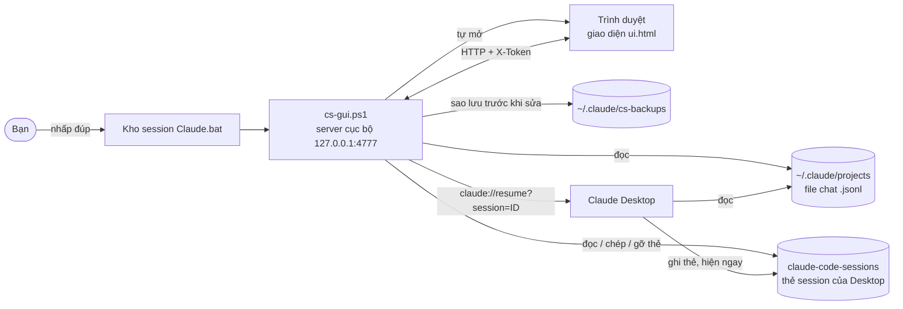
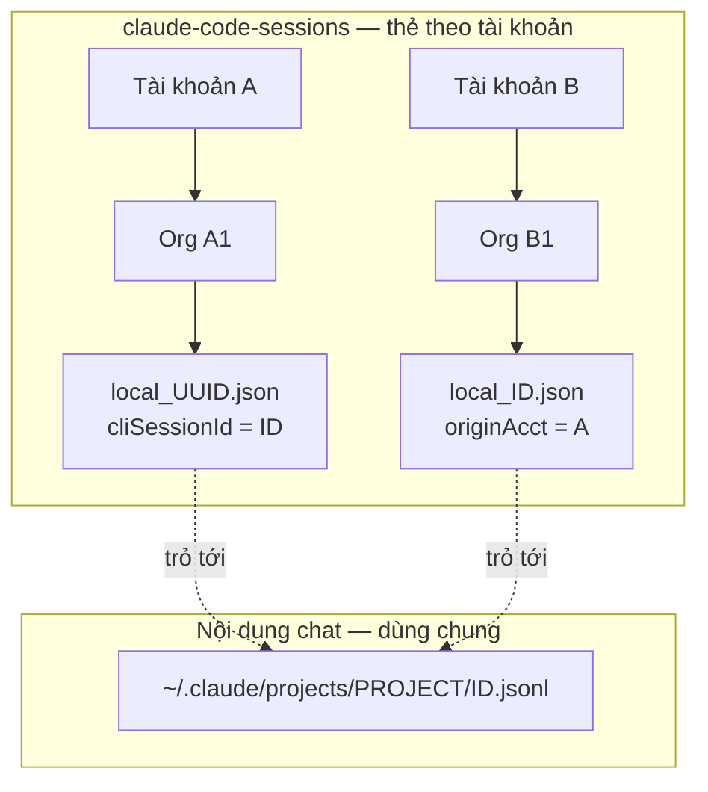
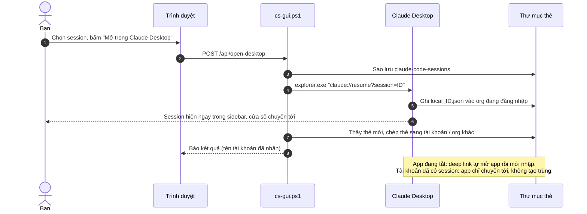
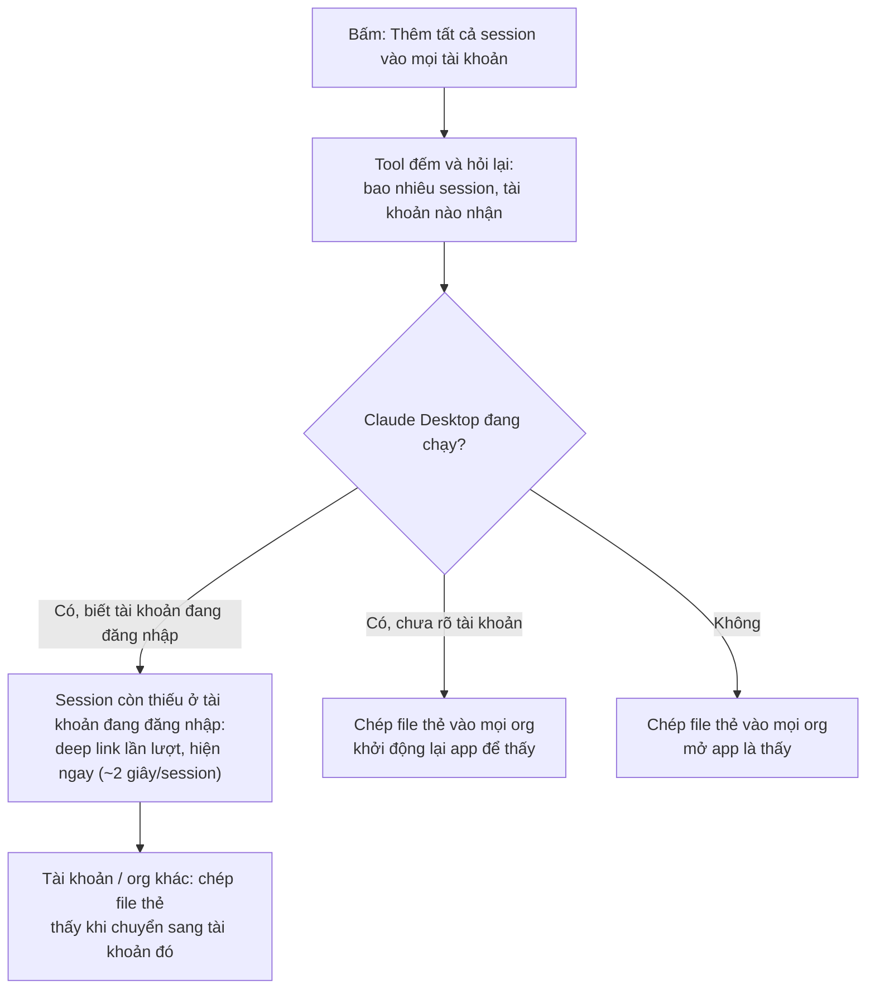

# Kho session Claude

Tool nhỏ cho **Windows** giúp nhiều tài khoản **Claude Desktop** trên cùng một máy **thấy chung session Claude Code**, và mở lại bất kỳ session cũ nào (kể cả session tạo từ terminal / VS Code) **mà không cần khởi động lại app**.

> *English:* A small local Windows tool (PowerShell 5.1, no install) that lets every Claude Desktop account on the same PC see and reopen the same Claude Code sessions, using the app's `claude://resume` deep link. Unofficial — not affiliated with Anthropic.

> [!WARNING]
> Đây **không phải** sản phẩm chính thức của Anthropic. Tool dựa vào cách Claude Desktop lưu dữ liệu trên máy và deep link `claude://resume` — cả hai đều chưa có tài liệu chính thức, bản cập nhật app có thể làm tool ngừng chạy. Tool tự sao lưu trước mỗi lần thay đổi.

---

## Vì sao cần

Khi dùng nhiều tài khoản Claude (đổi tài khoản lúc hết limit), mỗi lần đổi tài khoản trong Claude Desktop thì sidebar **chỉ hiện session của tài khoản đó**. Nội dung chat thật ra vẫn nằm chung trên máy (`~/.claude/projects`), chỉ là tài khoản mới "không biết" tới nó.

Kho session Claude liệt kê mọi session trên máy và đưa chúng vào tài khoản bạn cần — ngay lập tức, không restart app.

## Tính năng

- **Liệt kê mọi session** Claude Code trên máy (mọi project, mọi tài khoản), tìm theo tiêu đề / đường dẫn, xem trước nội dung chat.
- **Mở trong Claude Desktop** — session đang chọn vào ngay tài khoản đang đăng nhập (app tự chuyển tới nó), đồng thời được chép sang các tài khoản khác.
- **Thêm tất cả session vào mọi tài khoản** — một nút, mọi tài khoản trên máy thấy đủ session.
- **Thống kê theo tài khoản**: mỗi tài khoản đang có bao nhiêu session, chia ra *Tự tạo* / *Được thêm vào*; lọc riêng session *chưa có trong app*.
- **Gỡ** session khỏi các tài khoản không phải gốc.
- Chạy **hoàn toàn trên máy** (`127.0.0.1`), không gửi gì lên mạng, **không cần cài gì**, không cần quyền admin.

## Cài đặt và chạy

**Cần:** Windows 10/11 (đã có sẵn PowerShell 5.1) và Claude Desktop.

1. Bấm **Code → Download ZIP** ở đầu trang này (hoặc `git clone`).
2. **Trước khi giải nén:** chuột phải file zip → **Properties** → tích **Unblock** → OK. (Bỏ qua bước này thì lần chạy đầu Windows có thể hỏi *Security Warning* → bấm **Run**.)
3. Giải nén vào đâu cũng được, ví dụ Desktop.
4. Nhấp đúp **`Kho session Claude.bat`** → trình duyệt tự mở trang của tool.

Cửa sổ đen hiện ra là tool đang chạy nền — đóng nó để tắt tool.

## Dùng hằng ngày

| Nút | Phạm vi | Kết quả |
|---|---|---|
| **Mở trong Claude Desktop** (hoặc nhấp đúp / Enter) | **Chỉ** session đang chọn | Vào ngay tài khoản đang đăng nhập + chép sang tài khoản khác (thấy khi chuyển sang). Dùng được cho cả session "chưa có trong app". |
| **Thêm tất cả session vào mọi tài khoản** | **Mọi** session đã có trong Claude Desktop | Tài khoản đang đăng nhập nhận session còn thiếu (app lần lượt chuyển qua từng session, ~2 giây/session); tài khoản khác thấy khi chuyển sang. Tool hỏi lại trước khi chạy. |
| **⋯ → Gỡ tất cả khỏi tài khoản khác** | Mọi session | Mỗi session chỉ còn ở tài khoản đã tạo ra nó. |

Phím tắt: `↑` / `↓` chọn · `Enter` mở · `/` nhảy tới ô tìm · `Esc` đóng menu.

Hướng dẫn chi tiết cho người dùng cuối: [HƯỚNG DẪN.txt](HƯỚNG%20DẪN.txt).

## Sơ đồ

### Kiến trúc

### Claude Desktop lưu session thế nào

Mỗi session gồm **file chat** (dùng chung mọi tài khoản) và **thẻ** (mỗi tài khoản/org một bản — chính là một dòng trong sidebar). Tài khoản nào không có thẻ thì không thấy session đó.

Thư mục `claude-code-sessions` nằm ở một trong các chỗ sau (tool tự dò, nhiều chỗ cùng có thì chọn chỗ có thẻ ghi gần nhất):

| Cách cài Claude Desktop | Thư mục dữ liệu |
|---|---|
| Microsoft Store, bản mới trên Windows 11 (app tự chuyển dữ liệu ra ngoài gói) | `%LOCALAPPDATA%\Claude-Data\claude_<mã gói>\` |
| Microsoft Store | `%LOCALAPPDATA%\Packages\Claude_<mã gói>\LocalCache\Roaming\Claude\` |
| Bộ cài `.exe` | `%APPDATA%\Claude\` |
| Chế độ nhà cung cấp bên thứ ba (3P) | `%LOCALAPPDATA%\Claude-3p\` |

### Luồng "Mở trong Claude Desktop"

### Luồng "Thêm tất cả session vào mọi tài khoản"

## Bảo mật và quyền riêng tư

- Server chỉ nghe `127.0.0.1`, chỉ nhận header `Host` là `127.0.0.1` / `localhost` (chặn DNS rebinding), mọi API đòi header `X-Token` sinh ngẫu nhiên mỗi lần chạy (trang web khác không gọi được).
- **Không** gửi dữ liệu ra mạng, **không** đọc token / cấu hình đăng nhập của Claude Desktop, **không** tự đổi tài khoản, **không** sửa file chat `.jsonl`.
- Trước mỗi lần sửa thẻ, tool sao lưu `claude-code-sessions` vào `~/.claude/cs-backups` (giữ 5 bản gần nhất).
- ⚠️ Session đã được thêm vào nhiều tài khoản thì **bất kỳ ai đăng nhập một trong các tài khoản đó trên máy này** đều đọc được nội dung chat. Chỉ đồng bộ những gì bạn chấp nhận chia sẻ; dùng *Gỡ tất cả khỏi tài khoản khác* để thu lại.

## Giới hạn đã biết

- **Gỡ session khỏi tài khoản đang đăng nhập** cần tắt hẳn Claude Desktop (app giữ danh sách trong bộ nhớ và ghi lại thẻ khi session được bấm). Tool hỏi trước rồi tự tắt → gỡ → mở lại app; luồng Claude đang chạy trong app sẽ dừng.
- Tài khoản đang đăng nhập được nhận ra theo session bấm gần nhất trong app — vừa đổi tài khoản thì bấm một session bên đó trước.
- Pha "Thêm tất cả" làm cửa sổ app chuyển qua từng session (~2 giây/session).

## Cấu trúc thư mục

| File | Vai trò |
|---|---|
| `Kho session Claude.bat` | Nhấp đúp để chạy (tắt bản cũ đang chạy rồi khởi động `cs-gui.ps1`) |
| `cs-gui.ps1` | Chương trình: server HTTP cục bộ, đọc session, deep link, chép / gỡ thẻ, sao lưu |
| `ui.html` | Giao diện web |
| `HƯỚNG DẪN.txt` | Hướng dẫn cho người dùng cuối (đi kèm gói zip) |
| `dong-goi.ps1` | Đóng gói `Kho-session-Claude.zip` để gửi người khác |
| `CLAUDE.md` | Ghi chú kỹ thuật cho người phát triển (cách app lưu dữ liệu, các hướng đã thử, bẫy PowerShell 5.1) |

## Biến môi trường (tuỳ chọn)

| Biến | Ý nghĩa | Mặc định |
|---|---|---|
| `CS_PORT` | Cổng của server cục bộ | `4777` |
| `CS_DESKTOP_DIR` | Chỉ định thẳng thư mục `claude-code-sessions` | tự dò |
| `CLAUDE_CONFIG_DIR` | Thư mục cấu hình Claude Code (chứa `projects`) | `%USERPROFILE%\.claude` |
| `CS_NO_BROWSER` | `1` = không tự mở trình duyệt | — |

## Gặp lỗi

- **Cửa sổ đen báo lỗi đỏ rồi tắt**: máy có thể bị chính sách công ty chặn chạy script PowerShell — nhờ IT kiểm tra.
- **Dòng trên cùng báo "Chưa thấy dữ liệu Claude Desktop"**: nút *Mở trong Claude Desktop* vẫn dùng được. Cửa sổ đen có in các thư mục tool đã tìm — chụp lại khi báo lỗi.
- **Không thấy session nào**: mở Claude Desktop, dùng Claude Code ít nhất một lần rồi chạy lại tool.
- **Mở ra trang cũ / thiếu nút**: đóng cửa sổ đen cũ rồi chạy lại `.bat`.

## Phát triển

- Chỉ dùng PowerShell 5.1 + .NET có sẵn trong Windows — không module ngoài. Giao diện chỉ sửa trong `ui.html`.
- `.ps1` và `HƯỚNG DẪN.txt` **phải** là UTF-8 có BOM; `.bat` để ASCII + CRLF (`.gitattributes` giữ nguyên từng byte).
- Đọc/ghi thẻ bằng `JavaScriptSerializer`, **không** dùng `ConvertTo-Json` (làm bẹp trường lồng nhau, thêm BOM → app bỏ qua thẻ).
- Thử các thao tác ghi an toàn: chép thư mục thẻ ra thư mục tạm, chạy với `CS_DESKTOP_DIR=<bản chép>`, `USERPROFILE=<thư mục tạm>`, `CS_PORT` khác, `CS_NO_BROWSER=1`; kiểm `GET /api/sync-all` trả `hot:false` trước khi POST.
- Nạp hàm để thử riêng (không chạy server): `. .\cs-gui.ps1`.
- Đóng gói gửi người khác: `powershell -NoProfile -ExecutionPolicy Bypass -File dong-goi.ps1`.

Chi tiết kỹ thuật, các hướng đã thử và thất bại: [CLAUDE.md](CLAUDE.md).
